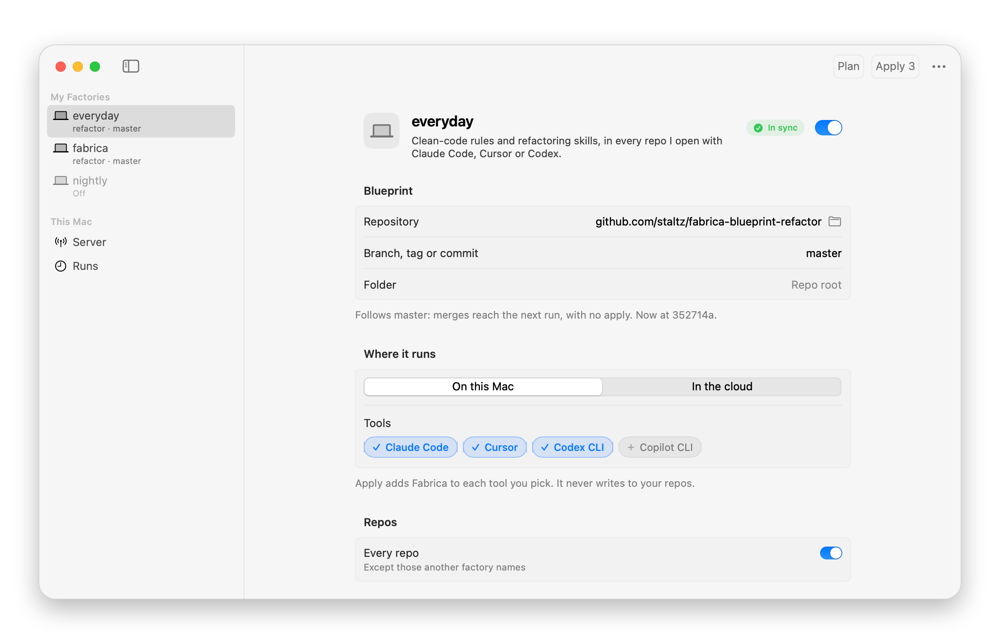

<p align="center">
  <picture>
    <source media="(prefers-color-scheme: dark)" srcset="docs/assets/logo-dark.png">
    
  </picture>
</p>

# Fabrica

> terraform for software factories

**_Fabrica_ is a software factory framework.** It lets you write down *how your AI agents build software* (skills, routines and rules) once, in a git repo, and run that same setup on many AI coding tools: Claude, Cursor, Codex, GitHub Copilot and more.

**Principles**:

* A factory is a *composable* collection of skills, rules, routines
* Generic skills and rules live outside of your product's repository, so your agents cannot change the rules
* Provisioning routines (a.k.a. "loops", "scheduled tasks") should be easy and independent of AI coding tools
* Reusing and composing factories should be instant
* Observability data for all agents in a factory, for people to read (`fabrica runs`, a dashboard) and not for agents

## Quick start

### 🪄✨ MAGIC PROMPT TO GET STARTED

Paste this into your favorite harness in your project's repository:

```markdown
I want you to use https://github.com/staltz/fabrica to set up a software factory for my project.

**Instructions:**
1. Read how Fabrica works
2. Install the `fabrica` CLI for me
3. Ask me if I want a local-only or a cloud-based factory, and with what AI harnesses
4. Create a new factory blueprint repository in a suitable location
5. Extract generic skills and rules from this product repository into the blueprint repository
6. Configure the factory in the home repo `~/.fabrica`
7. Use `fabrica plan` and `fabrica apply` to deploy the factory onto the product repository
8. Verify that it works
9. Report back to me with a simple summary (written in casual and conversational plain English) on: what changed in my product repository, how the factory was deployed, how it works, and follow ups to improve the factory.
```

## Motivation

If your team uses AI coding agents, your "how we work" knowledge probably ends up scattered all over the place:

- The same skills get copied into every repo's `.claude/skills/` folder.
- `AGENTS.md` files mix "how this app works" with "how we write code in general".
- A PR-review bot gets set up by hand in three different tools, and the three slowly drift apart.
- Nobody knows what the agents actually did last week.
- There is poor or no version control system for any of the above.

So when you improve your process, you have to update it manually everywhere. And when you switch tools, you start over.

Fabrica treats your agent setup as its own versioned thing, called a software factory **blueprint**, kept apart from the software it builds. Your product repo versions your code. Your blueprint repo versions the software factory. Deploy a blueprint to some product repos (called **targets**) in some tools, and that deployment is a **factory**.

## How it works

There are three kinds of repositories:

| Repo | What's in it |
|---|---|
| 🗺️ **Blueprint repo** | Skills, routines, rules and connectors: your process. It doesn't know who uses it, or what software it is specifically building. |
| 🏠 **Home repo** | A local (or team) repository that defines the factories: "run *this* blueprint on *these* targets in *these* tools". Targets are product repos. This is the only place blueprints and product repos meet. |
| 🚀 **Product repo** | Your software's code. The only Fabrica thing in it is one sentence at the top of its `AGENTS.md`. |

Then:

1. Write a factory blueprint or use a ready one from the community.
2. Configure the factory from your home repo `~/.fabrica/factories/my-factory.yaml`
3. Run `fabrica plan` to see what it will do.
4. Then run `fabrica apply`.

From then on, agents in those tools load your blueprint live over MCP. Even skills will be loaded live over MCP (one day we'll use [Skills Over MCP](https://modelcontextprotocol.io/community/working-groups/skills-over-mcp)). Fabrica never copies blueprint content into your tools or your product repos. For a routine like "review every new PR", it installs a tiny **stub** that basically says "load your instructions from Fabrica". So when you change a routine's instructions, skills or rules and merge that to git, the next run picks it up. No re-deploy needed.

A blueprint can also have an **init routine**, a one-off session that runs when `fabrica apply` creates a factory: say, to refactor the product repo before feature development. See [Init routines](manual/blueprints.md#init-routines).

## Install

Fabrica is a single static binary.

```sh
curl -fsSL https://raw.githubusercontent.com/staltz/fabrica/main/install.sh | bash
```

That puts `fabrica` in `~/.local/bin` (set `FABRICA_INSTALL_DIR` to change it). You also need `git`, since Fabrica runs it to read blueprints and to commit state. Later, `fabrica -u` updates it to the latest release.

On a Mac, you can use **Fabrica.app** instead: a menu bar app that installs the CLI too, edits your factories with forms, runs plan and apply, starts and stops a local Fabrica server, shows your run history, and keeps itself up to date. Download [Fabrica-macos.zip](https://github.com/staltz/fabrica/releases/latest/download/Fabrica-macos.zip) from the latest release, unzip it, and move Fabrica.app to Applications. See [macos/](macos/README.md).

<p align="center">
  <picture>
    <source media="(prefers-color-scheme: dark)" srcset="docs/assets/fabrica-app-dark.png">
    
  </picture>
</p>

Prefer building from source? You'll need Go 1.26 or newer:

```sh
go install github.com/staltz/fabrica/cmd/fabrica@latest
```

## Getting started

This sets up your own blueprint for every repo you work on, in Claude Code and Cursor.

**1. Make a blueprint.** Start from the [starter blueprint](examples/starter-blueprint/), which comes built into `fabrica`:

```sh
fabrica new ~/code/my-blueprint
cd ~/code/my-blueprint
fabrica check        # should say: No problems found.
git add . && git commit -m "My blueprint"
```

> 💛🖤💛🖤💛🖤💛🖤💛🖤💛🖤💛🖤💛🖤
> Optionally, you can use ready-made blueprints from the community. You can even *compose* them together, smaller blueprints into larger ones!
>
> - ⭐️ https://github.com/staltz/fabrica-blueprint-refactor
> - ⭐️ https://github.com/staltz/fabrica-blueprint-instant-factory
>
> You can even import good-old skills repositories into a blueprint!
> ```
> imports:
>   mattpocock-factory-skills:
>     git: github.com/mattpocock/skills
>     ref: main                # branch
>     path: skills/engineering # folder in the repo where the skills are
>     only: [skills/retro]     # list of skills to import
> ```
> 💛🖤💛🖤💛🖤💛🖤💛🖤💛🖤💛🖤💛🖤

Push it somewhere git can reach, like `github.com/you/my-blueprint`.

**2. Add a factory to your personal home repo** at `~/.fabrica`. Fabrica created it the first time you ran it (a git repo with an empty `factories/` folder), so just add a file:

```sh
cat > ~/.fabrica/factories/my-default.yaml <<'EOF'
blueprint: { git: github.com/you/my-blueprint, ref: main }
runtimes: [claude-code-local, cursor-local]
targets: ["*"]               # every repo not matched by another local factory
EOF
```

**3. Apply it.** This adds a user-level `fabrica` MCP server to Claude Code and Cursor. It never touches your product repos.

```sh
fabrica plan     # see what it will do
fabrica apply
```

**4. Add the Fabrica line to a product repo.** Make this the very first line of its root `AGENTS.md` (and of its root `CLAUDE.md`, if it has one):

```
Before starting, load this repo's working rules from the Fabrica MCP server; if you don't have it, ignore this line.
```

**5. Open the repo in Claude Code or Cursor.** The agent calls `run_begin`, loads your rules with `rules_get`, and loads skills as it needs them. Every session gets recorded in `~/.fabrica/runs.db`. Read the history with `fabrica runs`, or see it as charts and tables in your browser with `fabrica dashboard`.

The full walkthrough, including a team setup with a cloud PR reviewer, is in [manual/getting-started.md](manual/getting-started.md).

## Commands

| Command | What it does |
|---|---|
| `fabrica new <folder>` | Starts a new blueprint repo, from the starter blueprint or (with `--empty`) from scratch. |
| `fabrica check [folder]` | Lints a blueprint, validates a home repo's factories, or checks a product repo. It works out which one the folder is. |
| `fabrica lock` | Pins a blueprint's imports to exact commits, in `fabrica.lock`. |
| `fabrica upgrade [alias…]` | Moves imports to newer commits, showing a diff first. |
| `fabrica auth` | Shows the credentials `apply` needs (server secrets, runtime API keys, git access) and checks that each one works. `fabrica auth login` sets up what's missing, and saves it in your keychain. |
| `fabrica plan` | Shows what `apply` would do and what's blocking it. Exits `0` when in sync, `2` with changes, `1` with errors. |
| `fabrica apply` | Installs and updates stubs in runtimes, and sets up your local tools. |
| `fabrica destroy [factory…]` | The opposite of `apply`: removes everything it installed, and leaves your factory files alone. Asks first. |
| `fabrica confirm <id>` | Closes a handoff once someone has followed its instructions. |
| `fabrica unlock <factory>` | Removes a lock left behind by a crashed apply. |
| `fabrica runs` | Reads run history: lists runs, shows one in full (`runs show`), or exports a retro bundle for your own retro skill (`runs export`). |
| `fabrica dashboard` | Shows run history as charts and tables in your browser. It listens on your machine only. |
| `fabrica mcp [--http]` | Serves a blueprint over MCP: locally over stdio, or remotely over HTTP. |
| `fabrica -u` | Updates Fabrica itself to the latest release. |

Every command has `--help`. The full reference is in [manual/cli.md](manual/cli.md).

## Documentation

- [Getting started](manual/getting-started.md): a hands-on tutorial, solo and team.
- [Concepts](manual/concepts.md): blueprints, home repos, stubs, shapes and runs, explained.
- [Writing a blueprint](manual/blueprints.md): the blueprint format in full (skills, routines, init routines, rules, connectors, imports, expects).
- [Home repos](manual/home-repos.md): factories, state, the apply lock, handoffs and CI.
- [Product repos](manual/product-repos.md): the Fabrica line, repo skills and what stays out of product repos.
- [The MCP server](manual/mcp-server.md): the tools agents use, and how to run the remote server.
- [Providers](manual/providers.md): what each runtime supports, and how to write your own provider.
- [Credentials](manual/auth.md): what `apply` needs access to, and how `fabrica auth` sets it up and keeps it safe.
- [Run history](manual/run-history.md): who can read it, `fabrica runs`, the dashboard, the retro bundle, the SQLite schema and some handy queries.
- [Safety checks](manual/safety-checks.md): every way Fabrica fails closed, and where it catches each problem.
- [CLI reference](manual/cli.md): every command and flag.
- [Architecture](manual/architecture.md): how the code is organized, for contributors.

Examples live in [examples/](examples/): a [starter blueprint](examples/starter-blueprint/), a [home repo](examples/home/), a [product repo](examples/product-repo/) and a [custom provider](examples/custom-provider/).

## Limitations

- **Most built-in cloud providers use handoffs.** As of October 2026, Claude routines, Codex and Copilot automations have no API for creating triggered automations. So for those, `fabrica apply` writes step-by-step instructions (a **handoff**) for you, or an AI with computer use, to follow, and `fabrica confirm` records the result. Cursor automations are the exception: with a Cursor API key (`fabrica auth login cursor-cloud` sets one up), Fabrica manages them through Cursor's API (the one its Terraform provider uses), apart from a one-time setup of their MCP servers. If you write your own provider with an API, Fabrica drives it directly. See [manual/providers.md](manual/providers.md).
- **Cloud routines can only use text-only skills.** A skill with scripts or binary files needs its folder on disk, which only works locally for now.
- **A local agent with a shell can read local run history.** `~/.fabrica/runs.db` is a file on your disk. Fabrica's own tools never hand it to agents, but nothing can stop a shell from opening a file. See [Who can read it](manual/run-history.md#who-can-read-it).

## Contributing

- Pull requests are NOT welcome
- Issues are more than welcome! 🤗

## License

MIT. See [LICENSE](LICENSE).
